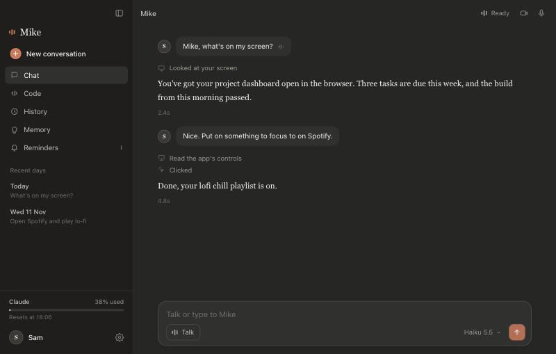

<p align="center"></p>

<h1 align="center">Mike</h1>
<p align="center"><b>A voice assistant that actually runs your computer.</b><br>
Say "Hey Mike". He hears you, talks back in a natural voice, and gets things done: opens apps, plays music,
sets reminders, remembers what you tell him, writes and runs code, makes PDFs and slides.<br>
Free models out of the box; your Claude plan if you have one.</p>

<p align="center">macOS · Windows · Linux (beta)</p>

<p align="center"></p>

---

## Install

**macOS** (Apple Silicon recommended), in Terminal:

```bash
curl -fsSL https://raw.githubusercontent.com/navdeepcodes/mike/main/install.sh | bash
```

**Windows 10/11**, in PowerShell:

```powershell
irm https://raw.githubusercontent.com/navdeepcodes/mike/main/install.ps1 | iex
```

**Linux**: same command as macOS; Mike opens in Chrome/Edge/Chromium as an app window.

The installer finds Python 3.10 to 3.12 (it offers to install 3.12 if you don't have it), sets Mike up in his
own private environment, downloads his voice models (about 150 MB, once), and adds him to your apps.
Nothing is installed system-wide.

Then:

1. Open **Mike** (Applications on a Mac, Start menu on Windows). A short setup asks for the microphone and a brain:
   - **Free (default): [Cloudflare Workers AI](https://dash.cloudflare.com/profile/api-tokens).** Any free Cloudflare
     account comes with a daily allowance. Paste your account ID and an API token with "Workers AI" access.
   - **Other free models:** [Groq](https://console.groq.com/keys), [Gemini](https://aistudio.google.com/apikey),
     [OpenRouter](https://openrouter.ai/keys), [OpenCode Zen](https://opencode.ai/auth) or
     [NVIDIA](https://build.nvidia.com). Add two or three: Mike switches when one is busy, and only uses free models there.
   - **GPT or Claude by API key:** [OpenAI](https://platform.openai.com/api-keys) or
     [Anthropic](https://console.anthropic.com/settings/keys), billed to your account.
   - **Your Claude plan:** install [Claude Code](https://docs.claude.com/en/docs/claude-code) and log in. Mike uses
     it first and falls back to the models above when you hit a limit.
   - Pick which one answers first in **Settings > Model > Preferred model**.
   - **Offline:** [Ollama](https://ollama.com) with a local model.
2. Say **"Hey Mike, what's the weather?"**

<p align="center"></p>

## What he can do

| | |
|---|---|
| **Talk** | Wake word ("Mike"), follow-ups without the name, talk over him to interrupt, natural neural voice |
| **His own browser** | A Chromium window he drives himself: researches, fills forms, compares prices, checks orders. You can watch and take over |
| **Run your computer** | Open apps and sites, play/pause/skip music, volume, click, type, shortcuts, screenshots |
| **Remember** | Long-term memory of what you tell him; "what did I say about…" searches past conversations |
| **Time** | Reminders, timers, alarms, repeating ones ("every weekday at 8"), spoken when due |
| **Make things** | PDFs, Word docs, slides, spreadsheets, charts, websites (via skills) |
| **Code by voice** | Finds your project, edits it, runs it in a terminal, fixes what breaks; a Code tab shows it all |
| **Know it's you** | Optional voiceprint, so a TV or other people can't trigger follow-ups |

### Platform support

| | macOS (Apple Silicon) | macOS (Intel, untested) | Windows | Linux (beta) |
|---|:-:|:-:|:-:|:-:|
| Voice in/out, memory, reminders, coding | ✅ | ✅ | ✅ | ✅ |
| Speech recognition | GPU (fast) | CPU | CPU | CPU |
| Click, type, keys, media, screenshots | ✅ | ✅ | ✅ | ✅ (X11) |
| Read an app's buttons by name | ✅ | ✅ | screenshot + click | screenshot + click |
| Desktop pet + ⌥Space hotkey | ✅ | ✅ | in the window | in the window |

## Privacy

- **Hearing and speaking happen on your computer.** Whisper (speech to text) and Kokoro (voice) run locally.
  Audio is never uploaded.
- What you *ask* goes to the model you chose (a free provider, Claude, or Ollama locally).
- Keys, memory and settings stay in `data/` inside Mike's folder, which git ignores.
- Anything risky (deleting files, sending messages, buying, posting, sudo, pushing code) asks you first.
- Mike never types passwords, card numbers or one-time codes; his browser asks you to type those yourself.

## Settings

Most things are in the app's Settings. Everything else is in [`config.py`](config.py), for example the
wake words, the port (`MIKE_PORT`), the speech models and the personality.

## Running from source

```bash
git clone https://github.com/navdeepcodes/mike && cd mike
./install.sh                 # or install.ps1 on Windows
./run.sh                     # backend in the terminal, with logs (Mac/Linux)
.venv/bin/python launch.py   # backend + window (Windows: .venv\Scripts\python launch.py)
python -m pytest -q tests    # quick checks, no models or keys needed
```

On a Mac, `./app/build.sh` rebuilds Mike.app (needs Xcode's command line tools).

How it fits together:

```
mic (browser audio worklet) ──► server.py ──► ears.py (Whisper) ──► brain.py (Claude Code)
                                    │                              └► fallback.py (free models)
speaker ◄── voice.py (Kokoro) ◄─────┘   tools: mike_tools.py, desktop.py / app/Control.swift, terminals.py
```

## Troubleshooting

- **He doesn't hear me:** check the mic permission (System Settings > Privacy > Microphone on a Mac; the
  lock icon in the window on Windows), and that the right input is selected.
- **"I don't have a brain set up yet":** add a free key in Settings > Model.
- **Logs:** `data/server.log`.

## Uninstall

Run `uninstall.ps1` (Windows: Start menu > Uninstall Mike) or `./uninstall.sh` (Mac/Linux) in Mike's folder.
Your memory, keys and settings stay in `data/` unless you set `MIKE_REMOVE_DATA=1`.

## Contributing

Issues and pull requests are welcome. Please run `python -m pytest -q tests` before sending a PR.
Good first areas: reading app buttons by name on Windows (UI Automation), a Linux Wayland backend,
more languages.

## License

[MIT](LICENSE)
