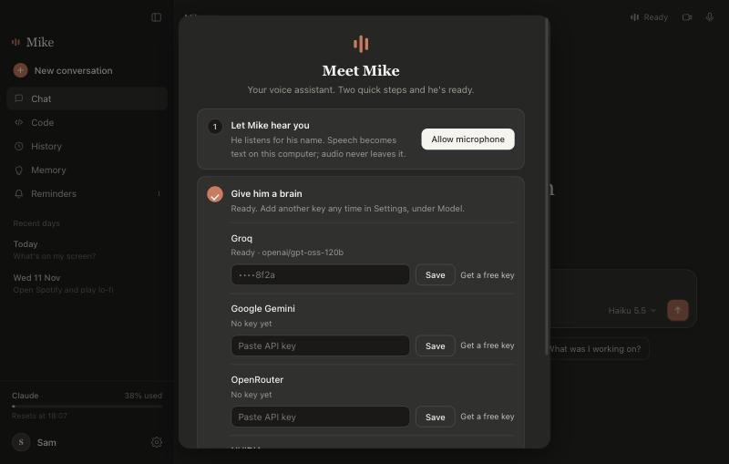

<p align="center"></p>

<h1 align="center">Mike</h1>
<p align="center"><b>A voice assistant that actually runs your computer.</b><br>
Say "Hey Mike". He hears you, talks back in a natural voice, and gets things done: opens apps, plays music,
sets reminders, remembers what you tell him, writes and runs code, makes PDFs and slides.<br>
Free models out of the box; your Claude plan if you have one.</p>

<p align="center">macOS · Windows · Linux (beta)</p>

<p align="center"></p>

---

## Install

**macOS** (Apple Silicon recommended), in Terminal:

```bash
curl -fsSL https://raw.githubusercontent.com/navdeepcodes/mike/main/install.sh | bash
```

**Windows 10/11**, in PowerShell:

```powershell
irm https://raw.githubusercontent.com/navdeepcodes/mike/main/install.ps1 | iex
```

**Linux**: same command as macOS; Mike opens in Chrome/Edge/Chromium as an app window.

The installer finds Python 3.10 to 3.12 (it offers to install 3.12 if you don't have it), sets Mike up in his
own private environment, downloads his voice models (about 150 MB, once), and adds him to your apps.
Nothing is installed system-wide.

Then:

1. Open **Mike** (Applications on a Mac, Start menu on Windows). A short setup asks for the microphone and a brain:
   - **Free (default): [Cloudflare Workers AI](https://dash.cloudflare.com/profile/api-tokens).** Any free Cloudflare
     account comes with a daily allowance. Paste your account ID and an API token with "Workers AI" access.
   - **Other free models:** [Groq](https://console.groq.com/keys), [Gemini](https://aistudio.google.com/apikey),
     [OpenRouter](https://openrouter.ai/keys), [OpenCode Zen](https://opencode.ai/auth) or
     [NVIDIA](https://build.nvidia.com). Add two or three: Mike switches when one is busy, and only uses free models there.
   - **GPT or Claude by API key:** [OpenAI](https://platform.openai.com/api-keys) or
     [Anthropic](https://console.anthropic.com/settings/keys), billed to your account.
   - **Your Claude plan:** install [Claude Code](https://docs.claude.com/en/docs/claude-code) and log in. Mike uses
     it first and falls back to the models above when you hit a limit.
   - Pick which one answers first in **Settings > Model > Preferred model**.
   - **Offline:** [Ollama](https://ollama.com) with a local model.
2. Say **"Hey Mike, what's the weather?"**

<p align="center"></p>

## What he can do

| | |
|---|---|
| **Talk** | Wake word ("Mike"), follow-ups without the name, talk over him to interrupt, natural neural voice |
| **His own browser** | A Chromium window he drives himself: researches, fills forms, compares prices, checks orders. You can watch and take over |
| **Run your computer** | Open apps and sites, play/pause/skip music, volume, click, type, shortcuts, screenshots |
| **Remember** | Long-term memory of what you tell him; "what did I say about…" searches past conversations |
| **Time** | Reminders, timers, alarms, repeating ones ("every weekday at 8"), spoken when due |
| **Make things** | PDFs, Word docs, slides, spreadsheets, charts, websites (via skills) |
| **Code by voice or typing** | Finds your project, edits it, runs it, fixes what breaks. The Code tab shows each step, asks before changes, and keeps your sessions |
| **Know it's you** | Optional voiceprint, so a TV or other people can't trigger follow-ups |

### Platform support

| | macOS (Apple Silicon) | macOS (Intel, untested) | Windows | Linux (beta) |
|---|:-:|:-:|:-:|:-:|
| Voice in/out, memory, reminders, coding | ✅ | ✅ | ✅ | ✅ |
| Speech recognition | GPU (fast) | CPU | CPU | CPU |
| Click, type, keys, media, screenshots | ✅ | ✅ | ✅ | ✅ (X11) |
| Read an app's buttons by name | ✅ | ✅ | screenshot + click | screenshot + click |
| Desktop pet + ⌥Space hotkey | ✅ | ✅ | in the window | in the window |

## The Code tab

Pick a project, then tell Mike what to build or fix. He reads the code, makes the change, runs it and keeps
going until it works.

- **Every step is visible.** Each read, edit and command appears as a step. Open a step to see the exact
  command and what it printed. A failed step turns red and opens itself, so errors are never hidden.
- **You approve changes.** With **Ask first** on (the default), Mike asks before every file edit and command:
  **Allow**, **Allow for this session** (stop asking for that kind of step until you start a new session) or
  **Deny**. Turn it off to be asked only about risky actions (deleting, pushing, installing, anything with
  `sudo`). Risky actions always ask, even after "Allow for this session".
- **Sessions are kept.** The clock button opens History: every past session with what you asked, each step and
  its output, and the project's changes and diffs at the end. Past sessions are read-only. **New session**
  starts fresh.
- **Paste screenshots.** Paste, drop or attach up to 4 images. Mike sends them only to a model he has checked
  can actually see images (each model gets a one-off test the first time). If none of your models can, he says
  so instead of guessing.
- **Edits stay in the project.** Mike's file tools refuse paths outside the open project. Commands get the
  project's own `.venv` (created on first use), never Mike's, so installing packages can't break Mike.
- **Plan** asks Mike to outline the change and wait for your OK before he touches anything.

## Models

Mike works with Claude Code if it's installed, and with free models from Cloudflare Workers AI, Groq,
NVIDIA, OpenRouter, Google Gemini and OpenCode Zen, plus OpenAI, the Claude API or Ollama if you add them.
Add keys in Settings > Model; all of them are used together.

- **Choice is learned, not hard-coded.** Every tool step a model takes is scored by whether it worked. Coding
  starts on the fastest model that is at least as capable as the median of the available ones. After 3 failed
  steps in a row, the task moves to the most capable one, with its history. Scores live in
  `data/model_stats.json` (delete it to start over).
- **Free-tier limits are handled the same way for every provider.** Rate limits wait for the first model to
  free up (up to 5 minutes while coding). A timeout, an empty reply or a used-up daily allowance sets aside only
  that model. Each model's request limit is learned from its own error messages, and long tasks are shortened
  to fit it.

## Privacy

- **Hearing and speaking happen on your computer.** Whisper (speech to text) and Kokoro (voice) run locally.
  Audio is never uploaded.
- What you *ask* goes to the model you chose (a free provider, Claude, or Ollama locally).
- Keys, memory and settings stay in `data/` inside Mike's folder, which git ignores.
- Anything risky (deleting files, sending messages, buying, posting, sudo, pushing code) asks you first.
- Mike never types passwords, card numbers or one-time codes; his browser asks you to type those yourself.

## Settings

Most things are in the app's Settings. Everything else is in [`config.py`](config.py), for example the
wake words, the port (`MIKE_PORT`), the speech models and the personality.

| Setting | Where | Default |
|---|---|---|
| Ask before edits and commands in the Code tab | **Ask first** in the Code tab, or `CODE_APPROVAL` (`ask` or `risky`) | `ask` |
| Port | `MIKE_PORT` | `8777` |
| Run without Claude Code | `MIKE_CLAUDE_BIN=none` | uses Claude Code if installed |
| Model keys | Settings > Model, saved in `data/secrets.json` | none |

What Mike keeps in `data/`: `secrets.json` (keys), `settings.json`, `memory` and `journal`,
`code_sessions/` (Code tab history, the newest 200 sessions), `model_stats.json` (learned model scores and
limits) and `models/` (voice models, downloaded on first start).

## Running from source

```bash
git clone https://github.com/navdeepcodes/mike && cd mike
./install.sh                 # or install.ps1 on Windows
./run.sh                     # backend in the terminal, with logs (Mac/Linux)
.venv/bin/python launch.py   # backend + window (Windows: .venv\Scripts\python launch.py)
python -m pytest -q tests    # quick checks, no models or keys needed
```

On a Mac, `./app/build.sh` rebuilds Mike.app (needs Xcode's command line tools).

How it fits together:

```
mic (browser audio worklet) ──► server.py ──► ears.py (Whisper) ──► brain.py (Claude Code)
                                    │                              └► fallback.py (free models)
speaker ◄── voice.py (Kokoro) ◄─────┘   tools: mike_tools.py, desktop.py / app/Control.swift, terminals.py
```

### Benchmark

`bench/` holds five coding tasks with hidden tests (a FastAPI app, debugging, a refactor, an expression
evaluator, a duplicate finder). `python -m bench.main_benchmark` runs them against your configured models.
`MIKE_BENCH_RUNS` (default 2) and `MIKE_BENCH_TIMEOUT` (seconds per run, default 480) are adjustable, because
free tiers can be slow. Run it on a copy with its own port (`MIKE_PORT`), never against the Mike you use: the
benchmark approves every step itself.

## Known limitations

- **Free tiers are small.** Groq allows about 8,000 tokens a minute and 200,000 a day per model; Cloudflare's
  free plan is 10,000 "neurons" a day, which one long coding task can use up. Mike waits and switches models,
  but long tasks on free models can be slow or stop until a limit resets.
- **Commands aren't sandboxed.** The project folder, the project's own `.venv` and approvals keep work
  contained, but an approved command runs with your user's permissions. Keep **Ask first** on for projects you
  care about.
- **Past sessions can't be resumed.** You can review them, but a new request starts a fresh conversation.
- **Images:** JPEG, up to 4 per message, about 5 MB each, and only with a model that can see. Many free models
  (for example Groq's gpt-oss) can't.
- **One window at a time.** Opening Mike's page in a second window or browser tab takes over from the first.
- **First start downloads about 150 MB** of voice models.

## Troubleshooting

- **He doesn't hear me:** check the mic permission (System Settings > Privacy > Microphone on a Mac; the
  lock icon in the window on Windows), and that the right input is selected.
- **"I don't have a brain set up yet":** add a free key in Settings > Model.
- **Logs:** `data/server.log`.

## Uninstall

Run `uninstall.ps1` (Windows: Start menu > Uninstall Mike) or `./uninstall.sh` (Mac/Linux) in Mike's folder.
Your memory, keys and settings stay in `data/` unless you set `MIKE_REMOVE_DATA=1`.

## Contributing

Issues and pull requests are welcome. Please run `python -m pytest -q tests` before sending a PR.
Good first areas: reading app buttons by name on Windows (UI Automation), a Linux Wayland backend,
more languages.

## License

[MIT](LICENSE)
